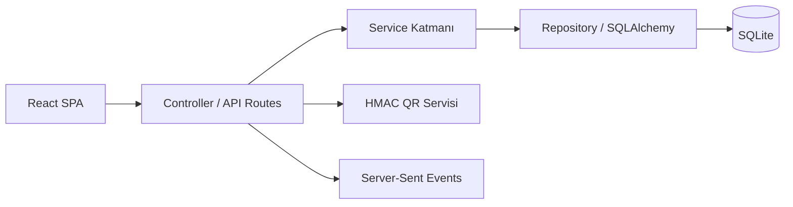

# KahveCell

Kurumsal mobil ödeme ve konum tabanlı kahve abonelik platformu.


## Proje Özeti

KahveCell, telekom operatörü abonelerinin anlaşmalı kahve dükkânlarından aylık paketler
ile sipariş verebildiği dijital abonelik platformudur. Kullanıcılar GSM numarasıyla
hesap oluşturur, abonelik satın alır, konumlarına göre dükkân keşfeder, ürün
özelleştirmeleriyle sipariş verir ve HMAC imzalı QR kodu ile teslim alır.

Üç kullanıcı rolü desteklenir: `CUSTOMER`, `SHOP_OWNER` ve `ADMIN`.

## Öne Çıkan Özellikler

- GSM kayıt ve 4 haneli OTP doğrulama
- Access ve refresh token tabanlı JWT oturumu
- Starter, Premium ve Unlimited abonelik paketleri
- Başarılı ve başarısız senaryolara sahip mock ödeme akışı
- Leaflet ile konum tabanlı dükkân keşfi
- Haversine formülü ile mesafe hesaplama
- Ürün özelleştirme, sipariş kredisi ve abonelik hak kontrolü
- HMAC-SHA256 imzalı QR kod oluşturma ve doğrulama
- `PENDING → ACCEPTED → PREPARING → READY → DELIVERED` sipariş yaşam döngüsü
- Dükkân sahibi sipariş yönetimi ve kamera tabanlı QR okutma
- Server-Sent Events ile anlık sipariş durum takibi
- Docker Compose ile full-stack çalışma

## Mimari Kararlar

| Alan | Tercih | Gerekçe |
|---|---|---|
| Backend | Python + FastAPI | Hızlı REST geliştirme, otomatik OpenAPI/Swagger ve güçlü veri doğrulama |
| Frontend | React + Vite + TypeScript | Modern bileşen mimarisi, hızlı geliştirme ve üretim derleme |
| Veritabanı | SQLite | Eğitim ve tek düğümlü kullanım için kurulum gerektirmeyen ilişkisel veri |
| Konum | Haversine formülü | Dükkân ve kullanıcı koordinatları arasındaki dünya yüzeyi mesafesini hesaplama |
| Harita | Leaflet + OpenStreetMap | Hafif, açık ve harita marker entegrasyonuna uygun çözüm |
| Gerçek zamanlı bildirim | Server-Sent Events | Sipariş izleme tek yönlü olduğundan WebSocket'e göre daha az karmaşık ve tarayıcı uyumlu |
| QR güvenliği | HMAC-SHA256 | QR içeriğine sır ile imza ekleyerek değiştirilmiş kodların reddedilmesi |
| State yönetimi | Zustand | Küçük ve okunabilir global oturum state'i |

SQLite ilişkisel demo ve değerlendirme hedefleri için uygundur. Çok düğümlü
ve yüksek eşzamanlı üretim kullanımı için PostgreSQL'e geçirilmesi önerilir.

### Katmanlı Mimari



```text
backend/
├── app/
│   ├── api/v1/       # REST endpoint controller katmanı
│   ├── core/         # JWT, QR ve SSE yardımcıları
│   ├── db/           # SQLAlchemy engine ve session
│   ├── models/       # Veritabanı entity modelleri
│   ├── schemas/      # Pydantic istek/cevap modelleri
│   ├── repositories/ # Veri erişim genişletme noktaları
│   └── services/     # İş kuralları genişletme noktaları
└── seed.py           # Tekrarlanabilir demo verisi

frontend/
└── src/
    ├── api/          # Axios istemcisi
    ├── components/   # Ortak UI bileşenleri
    ├── pages/        # Sayfa bileşenleri
    ├── store/        # Zustand oturum ve bildirim state'i
    └── types/        # TypeScript veri tipleri
```

## API Referansı

Swagger arayüzü: `http://localhost:8000/docs`

OpenAPI şeması: `http://localhost:8000/openapi.json`

| Alan | Metot | Endpoint | Açıklama |
|---|---|---|---|
| Kimlik | POST | `/api/v1/auth/register` | GSM ile kayıt ve OTP oluşturma |
| Kimlik | POST | `/api/v1/auth/request-otp` | Mevcut kullanıcı için OTP oluşturma |
| Kimlik | POST | `/api/v1/auth/verify-otp` | OTP doğrulama ve token üretimi |
| Kimlik | POST | `/api/v1/auth/login` | Telefon ve şifre ile giriş |
| Kimlik | POST | `/api/v1/auth/refresh` | Refresh token yenileme |
| Kimlik | GET/PATCH | `/api/v1/auth/me` | Kullanıcı bilgisi ve profil güncelleme |
| Abonelik | GET | `/api/v1/subscriptions/plans` | Paketleri listeleme |
| Abonelik | POST | `/api/v1/subscriptions` | Paket satın alma |
| Abonelik | GET/PATCH/DELETE | `/api/v1/subscriptions/me` | Aktif abonelik, paket değişimi, iptal |
| Ödeme | POST | `/api/v1/payments/process` | Mock ödeme işlemi |
| Ödeme | GET | `/api/v1/payments/history` | Kullanıcı ödeme geçmişi |
| Dükkân | GET | `/api/v1/shops` | Listeleme, arama ve konum sıralama |
| Dükkân | GET | `/api/v1/shops/{id}` | Dükkân detay ve menü |
| Dükkân | GET | `/api/v1/shops/{id}/menu` | Dükkân menüsü |
| Sipariş | POST | `/api/v1/orders` | Sipariş oluşturma |
| Sipariş | GET | `/api/v1/orders/history` | Kullanıcı sipariş geçmişi |
| Sipariş | GET | `/api/v1/orders/{id}` | Sipariş detayları |
| Sipariş | GET | `/api/v1/orders/shop/pending` | Dükkân sahibine ait siparişler |
| Sipariş | PATCH | `/api/v1/orders/{id}/status` | Sipariş durum geçişi |
| Sipariş | POST | `/api/v1/orders/{id}/verify-qr` | HMAC QR doğrulama |
| Sipariş | GET | `/api/v1/orders/{id}/stream` | SSE canlı durum akışı |

## Yerel Kurulum

### Gereksinimler

- Python 3.13+
- Node.js 20+
- npm
- Docker Desktop 4.x+ (Docker Compose kullanımı için)

### Backend

```powershell
cd backend
py -m venv .venv
.\.venv\Scripts\Activate.ps1
python -m pip install --upgrade pip
pip install -r requirements.txt
Copy-Item .env.example .env
python -m uvicorn app.main:app --host 127.0.0.1 --port 8000 --reload
```

Backend adresleri:

- Uygulama: `http://localhost:8000`
- Swagger: `http://localhost:8000/docs`
- Health: `http://localhost:8000/api/v1/health`

### Frontend

```powershell
cd frontend
npm install
Copy-Item .env.example .env.local
npm run dev
```

Frontend adresi: `http://localhost:5173`

### Docker Compose

```powershell
docker compose up --build
```

Arka planda çalıştırmak için:

```powershell
docker compose up --build -d
```

Durumlandırma için:

```powershell
docker compose ps
docker compose logs -f
docker compose down
```

## Demo Hesapları

| Rol | Telefon | Şifre | OTP |
|---|---|---|---|
| Müşteri | `05321234567` | `Ankara123!` | `1234` |
| Dükkân Sahibi | `05329876543` | `Sahip123!` | `1234` |

Demo kartları:

- Başarılı: `4242-4242-4242-4242`
- Başarısız: `4000-0000-0000-0002`

## Test Stratejisi

- Backend endpoint doğrulaması için pytest ve HTTP integration testleri
- Form, yönlendirme ve kullanıcı etkileşimleri için React Testing Library
- Ödeme, kredi düşümü ve durum geçişleri için negatif senaryo testleri
- HMAC imzası, token doğrulama ve rol yetkilendirme testleri
- Responsive görünüm ve mobil kamera izinlerinin manuel doğrulaması

Backend testleri:

```powershell
cd backend
.\.venv\Scripts\Activate.ps1
pytest
```

Frontend build ve lint:

```powershell
cd frontend
npm run build
npm run lint
```

## Ekran Görüntüleri

| Giriş ve Kayıt | Ana Sayfa ve Harita |
|---|---|
| `docs/screenshots/login.png` | `docs/screenshots/home.png` |

| Sipariş ve QR Takibi | Dükkân Sahibi Paneli |
|---|---|
| `docs/screenshots/qr.png` | `docs/screenshots/shop-owner.png` |

## Güvenlik Notları

- Gerçek anahtarlar repository'ye eklenmemelidir.
- `.env` dosyaları Git tarafından izlenmez.
- Üretimde uzun, rastgele JWT ve QR gizli anahtarları kullanılmalıdır.
- Gerçek ortamda OTP sağlayıcısı, ödeme sağlayıcısı ve HTTPS zorunludur.
